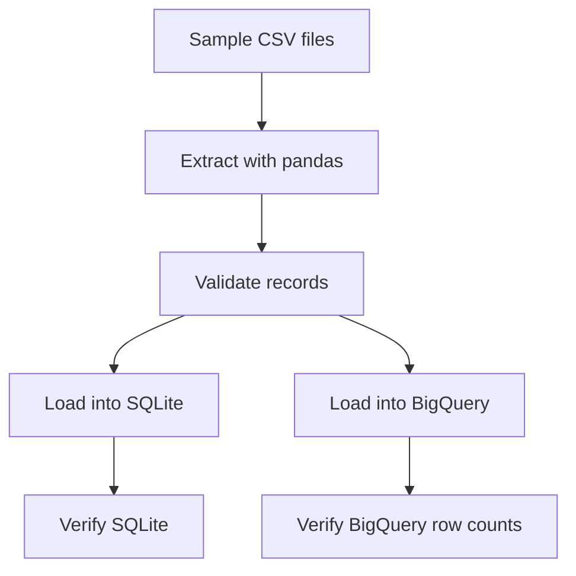

# Compass Mini — Secure Data Pipeline

A Python data pipeline that extracts, validates, and loads synthetic grants and payments data into SQLite and Google BigQuery.

## Project Overview

This project demonstrates backend data engineering practices, data validation, cloud integration, and basic security hygiene.

The pipeline:

1. Extracts grants and payments from CSV files.
2. Validates required fields, identifiers, amounts, statuses, and payment dates.
3. Loads validated records into a local SQLite database.
4. Verifies SQLite record counts.
5. Loads grants and payments into Google BigQuery.
6. Verifies BigQuery table row counts.

## Architecture



## Technology Stack

- Python 3.12
- pandas
- SQLite
- Google Cloud BigQuery
- Google Cloud Python client
- pytest
- uv

## Project Structure

```text
compass-mini-secure-data-pipeline/
├── data/
│   └── sample/
│       ├── grants.csv
│       └── payments.csv
├── ingestion/
│   ├── extract.py
│   ├── validate.py
│   ├── load.py
│   ├── bigquery_load.py
│   └── run_pipeline.py
├── tests/
│   ├── test_validation.py
│   └── test_bigquery_connection.py
├── .gitignore
├── pytest.ini
└── README.md
```

## Setup

### 1. Create and activate a virtual environment

```bash
uv venv --python 3.12
source .venv/bin/activate
```

### 2. Install dependencies

```bash
uv pip install pandas pytest python-dotenv google-cloud-bigquery pyarrow
```

### 3. Configure Google Cloud authentication

Install the Google Cloud CLI and authenticate using Application Default Credentials:

```bash
gcloud auth application-default login
```

The authenticated account needs permission to create and load tables in the target BigQuery dataset.

Do not commit access tokens, credential files, or secrets to Git.

### 4. Configure BigQuery

Update the project and dataset constants in `ingestion/bigquery_load.py` for your own Google Cloud environment. The configured dataset must exist, and its location must match the loader configuration.

## Run the Tests

```bash
python -m pytest -v
```

The project currently has eight passing tests, including validation tests and a BigQuery dataset connectivity test.

## Run the Pipeline

```bash
python -m ingestion.run_pipeline
```

The pipeline loads data into SQLite and BigQuery. The BigQuery loader uses `WRITE_EMPTY`, which prevents overwriting a destination table that already contains data. For repeatable runs, design a separate idempotent loading strategy before rerunning against populated tables.

## Verify BigQuery Row Counts

The verification function checks that the grants and payments tables contain five rows each:

```bash
python -c "from ingestion.bigquery_load import verify_bigquery_data; verify_bigquery_data()"
```

Expected output:

```text
BigQuery grants: 5 rows
BigQuery payments: 5 rows
BigQuery row-count verification passed.
```

## Security Practices

- Validate input data before loading.
- Keep virtual environments and local database files out of Git.
- Exclude environment files and common credential files using `.gitignore`.
- Use Google Cloud Application Default Credentials instead of hardcoding access tokens.
- Grant only the cloud permissions needed by the pipeline.
- Use synthetic sample data for development.

## Current Results

- 5 grant records loaded into SQLite.
- 5 payment records loaded into SQLite.
- 5 grant records loaded into BigQuery.
- 5 payment records loaded into BigQuery.
- 8 automated tests passing.
- BigQuery row-count verification successful.

## Future Improvements

- Add structured logging and clearer error handling.
- Add schema and data-quality checks for BigQuery.
- Add automated tests for the BigQuery loader using mocks.
- Add CI checks for tests and formatting.
- Introduce an idempotent loading strategy for repeatable pipeline runs.

## Disclaimer

This is a portfolio demonstration using synthetic data. It is not intended for production use without additional security, monitoring, access-control, and operational safeguards.
