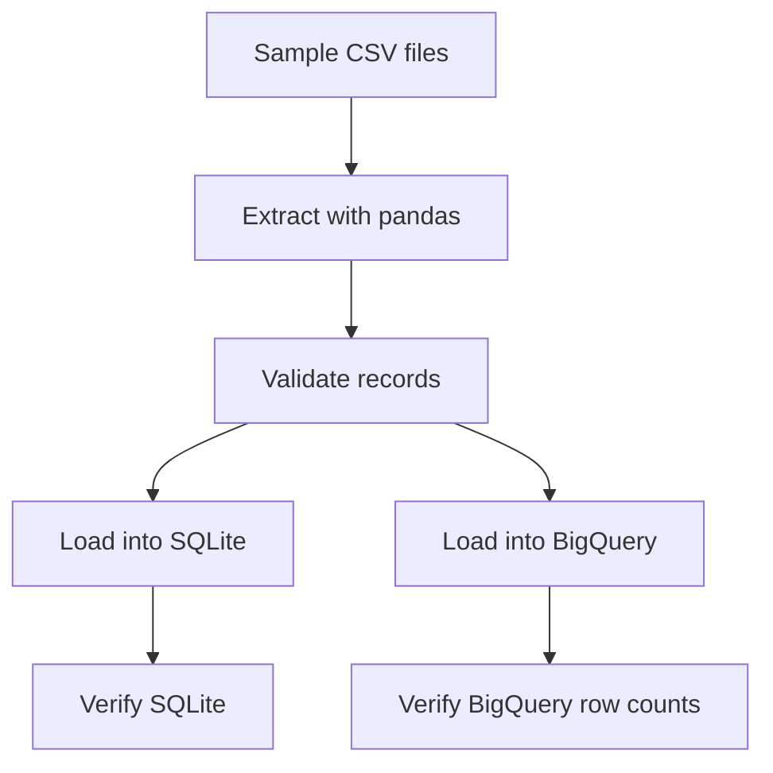

# Compass Mini — Secure Data Pipeline

A Python data pipeline that extracts, validates, and loads synthetic grants and payments data into SQLite and Google BigQuery.

## Project Overview

This project demonstrates backend data engineering practices, data validation, cloud integration, and basic security hygiene.

The pipeline:

1. Extracts grants and payments from CSV files.
2. Validates required fields, identifiers, amounts, statuses, and payment dates.
3. Loads validated records into a local SQLite database.
4. Verifies SQLite record counts.
5. Loads grants and payments into Google BigQuery.
6. Verifies BigQuery table row counts.

## Architecture



## Technology Stack

- Python 3.12
- pandas
- SQLite
- Google Cloud BigQuery
- Google Cloud Python client
- pytest
- uv
- pyarrow

## Project Structure

```text
compass-mini-secure-data-pipeline/
├── data/
│   └── sample/
│       ├── grants.csv
│       └── payments.csv
├── ingestion/
│   ├── __init__.py
│   ├── extract.py
│   ├── validate.py
│   ├── load.py
│   ├── bigquery_load.py
│   └── run_pipeline.py
├── tests/
│   ├── test_validation.py
│   └── test_bigquery_connection.py
├── .gitignore
├── pytest.ini
└── README.md
```

## Setup

### 1. Create and activate a virtual environment

```bash
uv venv --python 3.12
source .venv/bin/activate
```

### 2. Install dependencies

```bash
uv pip install pandas pytest python-dotenv google-cloud-bigquery pyarrow
```

### 3. Configure Google Cloud authentication

Install the Google Cloud CLI, then authenticate using Application Default Credentials:

```bash
gcloud auth application-default login
```

The authenticated account needs the permissions required to access the target BigQuery dataset and load tables.

Do not commit access tokens, credential files, or secrets to Git.

### 4. Configure BigQuery

Set the Google Cloud project ID and dataset name through environment variables:

```bash
export GOOGLE_CLOUD_PROJECT="your-google-cloud-project-id"
export BIGQUERY_DATASET="your_dataset_name"
```

Replace the example values with your own Google Cloud project ID and dataset name when running the project.

The dataset must already exist, and its location must match the location configured in `ingestion/bigquery_load.py`. The current implementation uses the `EU` location.

The loader uses Google Cloud Application Default Credentials for authentication. It does not require access tokens to be stored in source code.

## Run the Tests

```bash
python -m pytest -v
```

The project currently has eight passing tests, including input validation tests and a BigQuery dataset connectivity test.

The BigQuery connectivity test requires valid Google Cloud authentication and access to the configured dataset.

## Run the Pipeline

```bash
python -m ingestion.run_pipeline
```

The pipeline validates the sample data, loads it into SQLite, verifies the local database, loads the records into BigQuery, and verifies the BigQuery row counts.

The BigQuery loader uses `WRITE_EMPTY`, which prevents a load job from overwriting a destination table that already contains data. Because the destination tables already exist after a successful run, the same load operation is not automatically repeatable.

For repeatable production runs, implement and test an appropriate idempotent loading strategy.

## Verify BigQuery Row Counts

The verification function checks that the `grants` and `payments` tables each contain five rows:

```bash
python -c "from ingestion.bigquery_load import verify_bigquery_data; verify_bigquery_data()"
```

Expected output:

```text
BigQuery grants: 5 rows
BigQuery payments: 5 rows
BigQuery row-count verification passed.
```

## Security Practices

- Validate input data before loading.
- Keep virtual environments and local database files out of Git.
- Exclude environment files and credential files using `.gitignore`.
- Use Google Cloud Application Default Credentials instead of hardcoding access tokens.
- Use environment variables for project configuration.
- Grant only the cloud permissions needed by the pipeline.
- Use synthetic sample data during development